<div align="center">

# 📈 Multi-Algorithm Stock Predictor


*Advanced ensemble machine learning system for stock price prediction with real-time analysis and sentiment intelligence*

[🚀 Features](#-features) • [📖 Usage](#-usage) • [🛠️ Installation](#️-installation) • [📊 Demo](#-demo)

</div>

---

## 📌 Introduction

The **Multi-Algorithm Stock Predictor** is a sophisticated financial analysis platform that combines seven different machine learning algorithms with real-time market data and sentiment analysis to generate comprehensive stock price predictions. Built with modern web technologies, this application provides traders and investors with actionable insights through an intuitive Streamlit interface.

> ⚠️ **Important Disclaimer**: This tool is for educational and research purposes only. Stock predictions are inherently uncertain and should not be used as the sole basis for investment decisions.

---

## 🚀 Features

### 🧠 **Multi-Model Ensemble Prediction**
- **7 Machine Learning Algorithms**: LSTM, XGBoost, Random Forest, SVR, Gradient Boosting, KNN, ARIMA
- **Weighted Ensemble**: Configurable model weights for different market conditions
- **Confidence Scoring**: Built-in confidence assessment for prediction reliability
- **Model Consensus Analysis**: Agreement strength across prediction models

### 📊 **Advanced Technical Analysis**
- **Moving Averages**: 20-day, 50-day, 200-day SMAs with crossover analysis
- **Technical Indicators**: RSI, MACD, Bollinger Bands, Stochastic, Williams %R, ADX
- **Volume Analysis**: Volume trends and momentum indicators
- **Volatility Metrics**: ATR, volatility bands, and risk assessment

### 📈 **Prophet Time Series Forecasting**
- **Customizable Horizon**: 7-365 day forecast periods
- **Seasonality Detection**: Automatic pattern recognition
- **Confidence Intervals**: Statistical uncertainty bounds
- **Business Day Logic**: Excludes weekends for accurate market predictions

### 📰 **Real-Time Market Intelligence**
- **Live News Integration**: Real-time financial news via NewsAPI
- **Sentiment Analysis**: AI-powered news sentiment scoring with financial context
- **Market Sentiment Consensus**: Aggregated sentiment from multiple sources
- **Financial Context Enhancement**: Specialized financial keyword analysis

### 🎯 **Trading Signal Generation**
- **Multi-Factor Signals**: Combines technical, fundamental, and sentiment analysis
- **Risk Assessment**: Volatility and confidence-based risk scoring
- **Scenario Planning**: Bullish, bearish, and base case projections
- **Interactive Charts**: Plotly-powered visualizations with technical overlays

---

## 📸 Screenshots

<div align="center">

### Main Dashboard
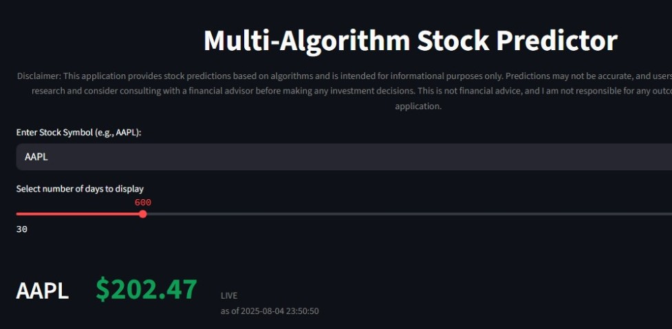

*Interactive stock price charts with technical indicators and real-time price display*

### Model Configuration & Predictions
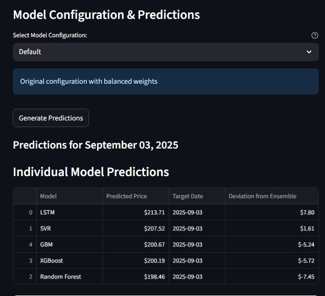
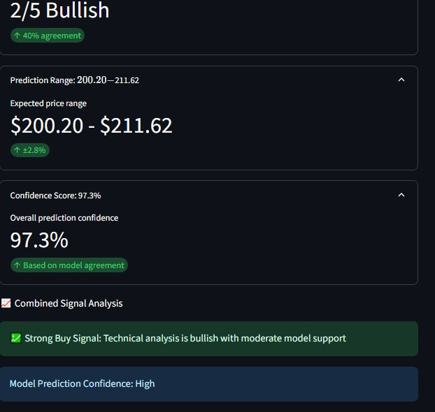

*Configurable model weights and ensemble prediction results*

### News Sentiment Analysis
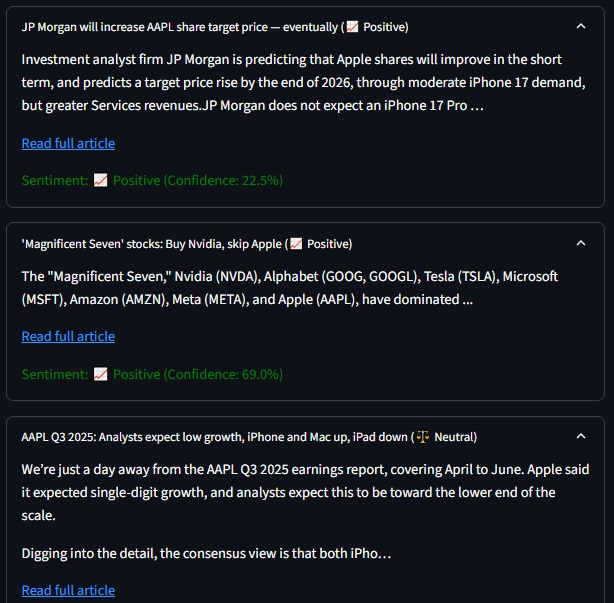
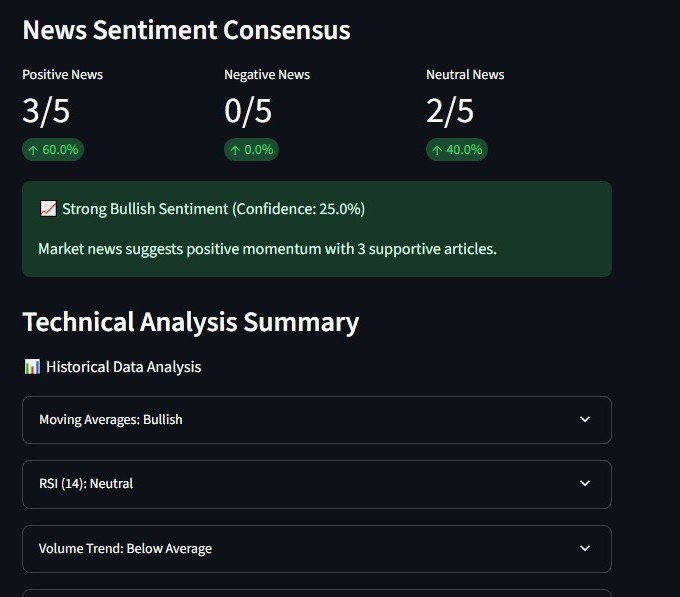

*Real-time financial news integration with AI-powered sentiment analysis*

### Advanced Analytics
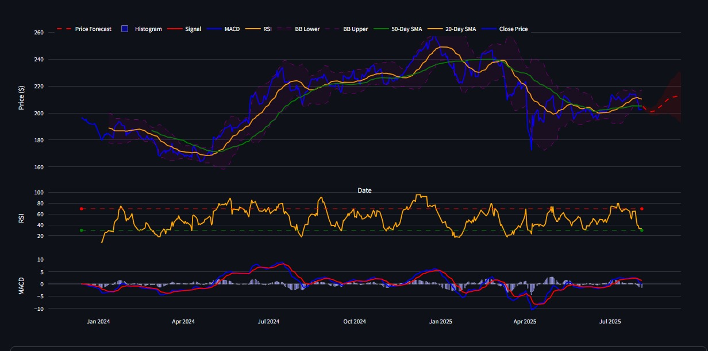
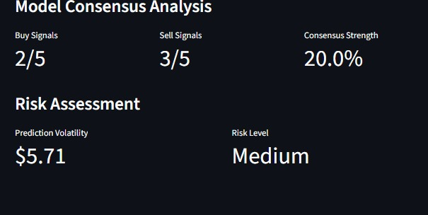

*Technical indicators visualization and model consensus analysis*

### Trading Insights
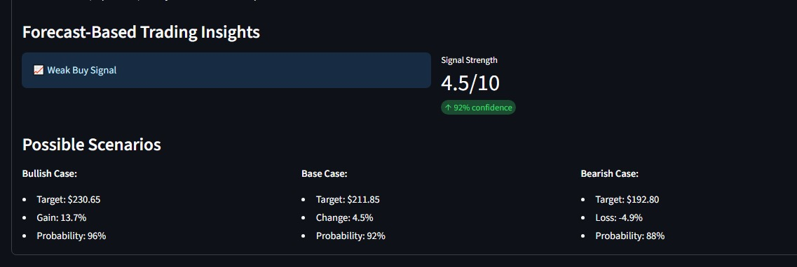

*Comprehensive trading signals and forecast-based insights*

</div>

---

## 🖼️ Project Diagrams

<div align="center">

### System Architecture
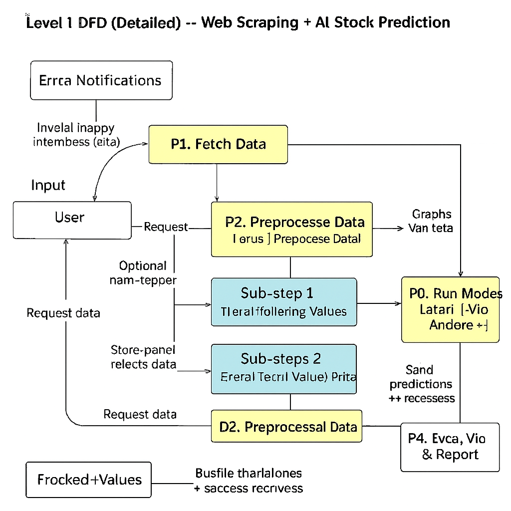

*Data flow diagram showing the complete system architecture and data processing pipeline*

### Entity Relationship
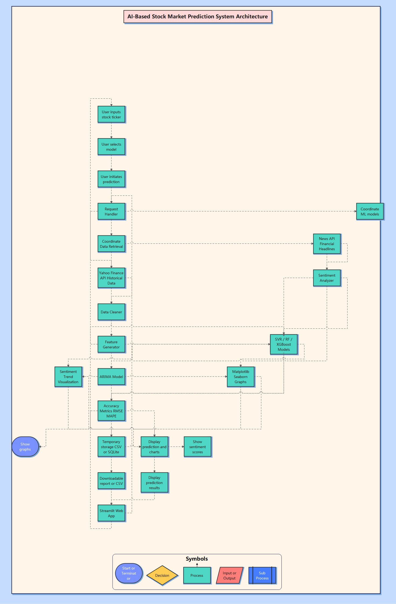

*Entity relationship diagram illustrating data model and relationships*

### Use Case Diagram
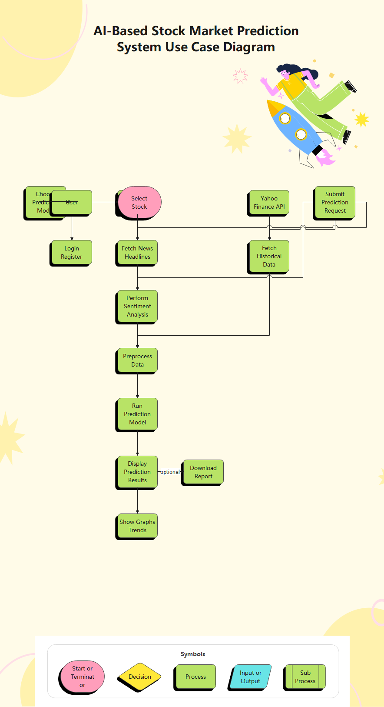

*Use case diagram showing user interactions and system capabilities*

### Sequence Diagram
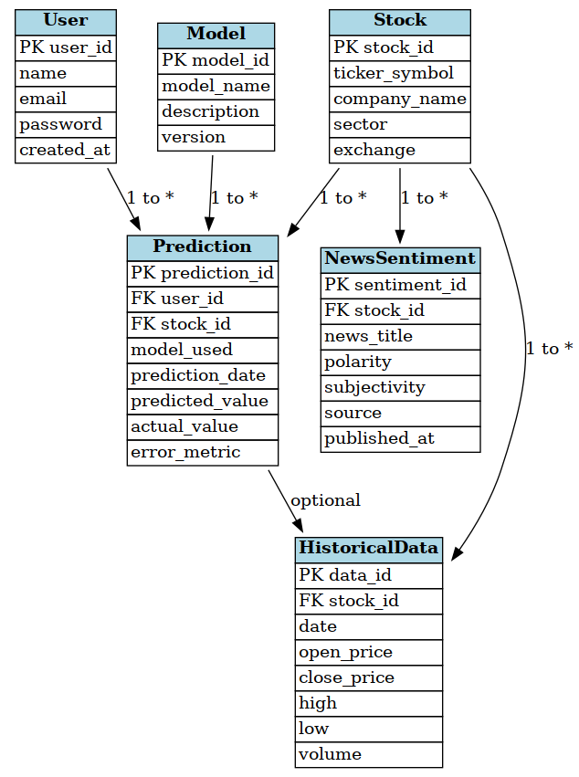

*Sequence diagram demonstrating the prediction workflow and system interactions*

</div>

---

## 🛠️ Tech Stack

| Category | Technology | Purpose |
|----------|------------|---------|
| **Frontend** | Streamlit | Interactive web interface and dashboard |
| **ML Framework** | TensorFlow, Scikit-learn | Deep learning and traditional ML models |
| **Time Series** | Prophet, ARIMA, Statsmodels | Advanced forecasting and time series analysis |
| **Data Processing** | Pandas, NumPy | Data manipulation and numerical computing |
| **Visualization** | Plotly, Matplotlib | Interactive charts and technical analysis graphs |
| **Data Sources** | yfinance, NewsAPI | Real-time market data and financial news |
| **NLP** | NLTK, TextBlob | Sentiment analysis and text processing |
| **Optimization** | XGBoost | Gradient boosting and ensemble methods |
| **Deployment** | Python 3.8+ | Cross-platform compatibility |

---

## ⚙️ Installation

### Prerequisites
- Python 3.8 or higher
- pip package manager
- Git (for cloning)

### Step-by-Step Setup

1. **Clone the repository**
   ```bash
   git clone https://github.com/yourusername/stock-predictor.git
   cd stock-predictor
   ```

2. **Create a virtual environment** (Recommended)
   ```bash
   python -m venv venv
   source venv/bin/activate  # On Windows: venv\Scripts\activate
   ```

3. **Install dependencies**
   ```bash
   pip install -r requirements.txt
   ```

4. **Set up API keys** (Optional)
   ```bash
   # For enhanced news analysis, add your NewsAPI key to stock_predictor.py
   # Replace the existing API key with your own
   ```

5. **Run the application**
   ```bash
   streamlit run stock_predictor.py
   ```

6. **Access the application**
   - Open your browser and navigate to `http://localhost:8501`
   - Enter a stock symbol (e.g., AAPL, GOOGL, TSLA)
   - Configure your analysis parameters

---

## 📖 Usage

### 🎯 **Basic Workflow**

1. **Enter Stock Symbol**: Input any valid stock ticker symbol
2. **Select Timeframe**: Choose historical data period (30-3650 days)
3. **Configure Models**: Select from 6 different model configurations
4. **Generate Predictions**: Click "Generate Predictions" for ensemble analysis
5. **Analyze Results**: Review technical indicators, news sentiment, and trading signals

### ⚙️ **Model Configurations**

| Configuration | Best For | Description |
|---------------|----------|-------------|
| **Default** | General purpose | Balanced weights across all models |
| **Trend-Focused** | Growth stocks, tech stocks | Emphasizes LSTM and XGBoost |
| **Statistical** | Blue chip stocks, utilities | Higher weight on ARIMA and statistical models |
| **Tree-Ensemble** | Complex market relationships | Focuses on tree-based algorithms |
| **Balanced** | Unknown stock characteristics | Equal emphasis on all model types |
| **Volatility-Focused** | Small cap, emerging markets | Optimized for high-volatility stocks |

### 📊 **Chart Controls**

- **Moving Averages**: Toggle 20-day and 50-day SMAs
- **Bollinger Bands**: Show volatility bands
- **Technical Indicators**: Display RSI and MACD subplots
- **Forecast Horizon**: Adjust prediction timeframe (7-365 days)

### 📈 **Trading Signals**

The system generates signals based on:

- **Price Change Percentage**
  - Strong: >10% predicted change
  - Moderate: 3-10% predicted change
  - Weak: 1-3% predicted change
  - Hold: <1% predicted change

- **Confidence Scores**
  - High: >0.8
  - Medium: 0.6-0.8
  - Low: <0.6

---

## 🤝 Contributing

We welcome contributions to improve the Multi-Algorithm Stock Predictor! Here's how you can help:

### 🐛 **Bug Reports**
- Use the GitHub Issues tab
- Include detailed error messages and steps to reproduce
- Specify your Python version and operating system

### 💡 **Feature Requests**
- Suggest new technical indicators
- Propose additional ML models
- Request UI/UX improvements

### 🔧 **Development**
1. Fork the repository
2. Create a feature branch (`git checkout -b feature/amazing-feature`)
3. Commit your changes (`git commit -m 'Add amazing feature'`)
4. Push to the branch (`git push origin feature/amazing-feature`)
5. Open a Pull Request

### 📋 **Code Guidelines**
- Follow PEP 8 style guidelines
- Add docstrings to new functions
- Include unit tests for new features
- Update documentation as needed

---

## 📄 License

This project is licensed under the MIT License - see the [LICENSE](LICENSE) file for details.

```
MIT License

Copyright (c) 2024 Multi-Algorithm Stock Predictor

Permission is hereby granted, free of charge, to any person obtaining a copy
of this software and associated documentation files (the "Software"), to deal
in the Software without restriction, including without limitation the rights
to use, copy, modify, merge, publish, distribute, sublicense, and/or sell
copies of the Software, and to permit persons to whom the Software is
furnished to do so, subject to the following conditions:

The above copyright notice and this permission notice shall be included in all
copies or substantial portions of the Software.
```

---

## ⭐ Support

### 🆘 **Getting Help**
- **Documentation**: Check this README and code comments
- **Issues**: Use GitHub Issues for bug reports and questions
- **Discussions**: Join GitHub Discussions for community support

### 🔗 **Connect**
- **GitHub**: [@yourusername](https://github.com/yourusername)
- **LinkedIn**: [Your Profile](https://linkedin.com/in/yourprofile)
- **Email**: your.email@example.com

### 💖 **Show Your Support**
- ⭐ Star this repository if you found it helpful
- 🍴 Fork it if you want to contribute
- 📢 Share it with others who might benefit

---

## ⚠️ Important Disclaimers

### 🚨 **Financial Disclaimer**
- This tool is for **educational and research purposes only**
- **Not financial advice** - always consult with a financial advisor
- Past performance does not guarantee future results
- Stock markets are inherently unpredictable and risky

### 🔬 **Technical Limitations**
- Cannot predict black swan events or unexpected news
- Less accurate during extreme market volatility
- Requires quality historical data for reliable predictions
- May not capture fundamental company changes

### 📊 **Model Performance**
- Predictions are based on historical patterns
- Market conditions can change rapidly
- Always combine with fundamental analysis
- Use as one tool among many in your investment strategy

---

<div align="center">

**Made with ❤️ for the financial analysis community**

*Last updated: September 2025*

</div>
